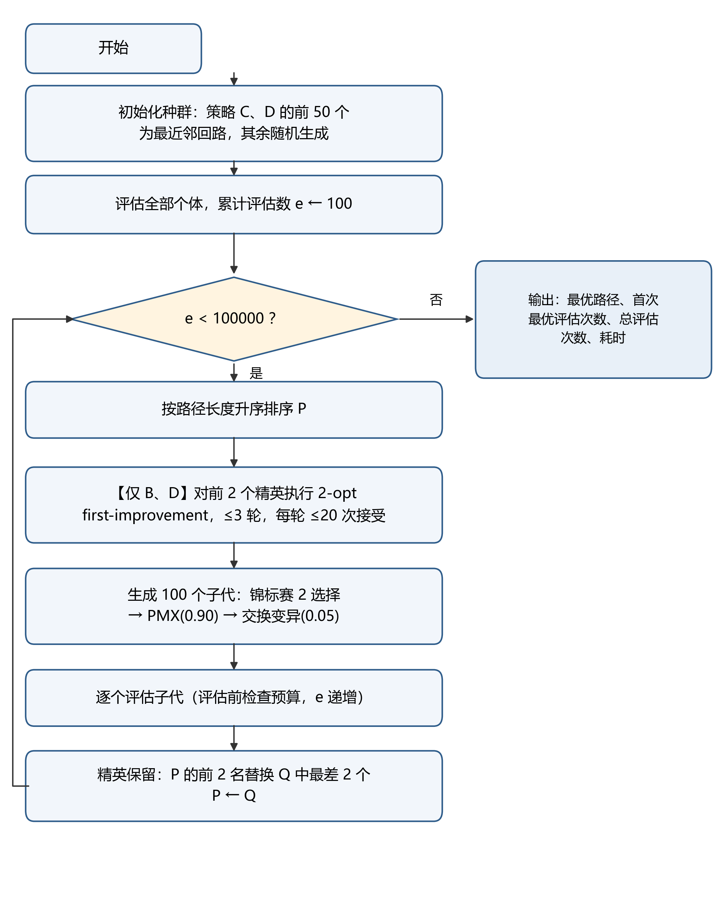
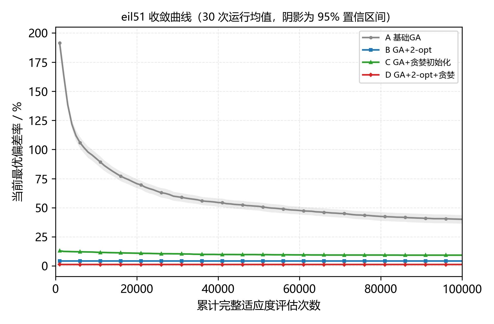
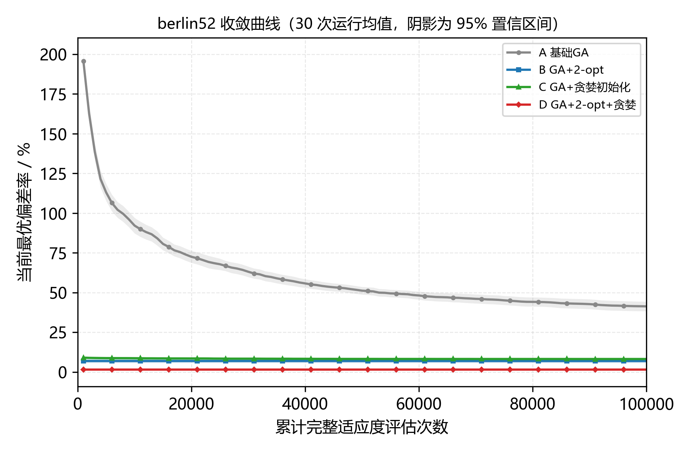
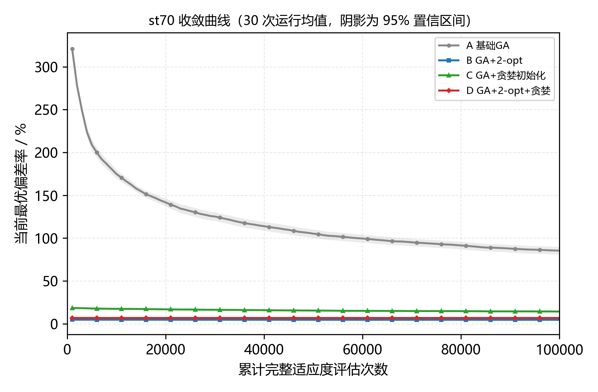
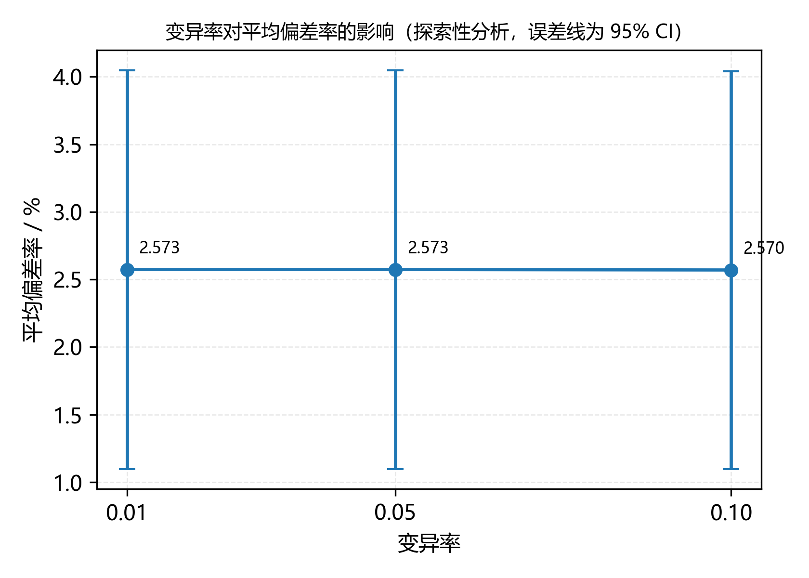

# 遗传算法求解 TSP 及其 2-opt 局部搜索改进

## ——基于 TSPLIB 小规模实例的复现实验

## 摘　要

针对旅行商问题（TSP），本文在统一参数与统一评估预算（100000 次完整适应度评估）下构建 2×2 因子实验，检验 2-opt 局部搜索与贪婪（最近邻）初始化两项改进的独立效应与交互效应。实验在 TSPLIB 的 eil51、berlin52、st70 三个实例上进行，4 种策略 × 3 个实例 × 30 个随机种子共 360 次运行，并以 10 城市实例的 9! 穷举最优解校验实现正确性。结果表明：2-opt 使三实例平均偏差率由 40.10%、41.30%、85.41% 降至 4.22%、6.89%、4.65%，贪婪初始化使其降至 9.30%、8.15%、14.34%，两项改进的独立效应均显著（p<0.001）；二者存在显著正向交互（F=216.54、237.63、1060.92，p<0.001），说明收益部分重叠，且在 st70 上含 2-opt 时加入贪婪初始化反而显著变差（6.95% 对 4.65%）。行为诊断显示，基础 GA 在约 100 代内多样性崩溃，终止时平均仅存 4—5 个不同个体；2-opt 仅消耗 0.02%—0.40% 的评估预算，却贡献了主要精度提升。变异率敏感性实验（60 次运行）未观察到可分辨差异。

**关键词**：旅行商问题；遗传算法；2-opt 局部搜索；贪婪初始化；因子实验

## Abstract

To examine how 2-opt local search and greedy (nearest-neighbour) initialization affect a genetic algorithm (GA) for the traveling salesman problem (TSP), this paper conducts a 2×2 factorial experiment under identical parameters and an identical budget of 100,000 complete fitness evaluations. Four strategies are compared: A (plain GA), B (GA with 2-opt), C (GA with greedy initialization) and D (GA with both). They are tested on three TSPLIB instances (eil51, berlin52 and st70) with 30 random seeds each, giving 360 runs, and a 10-city instance solved by exhaustive enumeration of all 9! tours is used to verify the implementation. The results show that 2-opt reduces the mean deviation from the best-known solution from 40.10%, 41.30% and 85.41% to 4.22%, 6.89% and 4.65%, while greedy initialization reduces it to 9.30%, 8.15% and 14.34%; both effects are significant in paired Wilcoxon signed-rank tests (p<0.001, Holm-corrected). A significant positive interaction is found (F=216.54, 237.63 and 1060.92; p<0.001), indicating that the gains of the two mechanisms overlap; on st70, greedy initialization even degrades performance once 2-opt is present (6.95% versus 4.65%). Diagnostics show that the plain GA loses population diversity within about 100 generations, with only 4-5 distinct individuals remaining on average at termination, and that 2-opt consumes only 0.02%-0.40% of the evaluation budget while delivering most of the accuracy gain. An exploratory sensitivity experiment on the mutation rate (60 runs) shows no discernible difference. The study suggests that, under this parameter setting, the bottleneck lies in maintaining diversity in the general search rather than in the strength of local search.

**Keywords**: traveling salesman problem; genetic algorithm; 2-opt local search; greedy initialization; factorial experiment

---

## 1 绪论

### 1.1 研究背景

旅行商问题（Traveling Salesman Problem，TSP）要求旅行商从某一城市出发，恰好访问给定的一组城市各一次并返回出发点，使总行程最短。以 n 个城市、城市间距离 d(i,j) 定义，其目标是求一个排列 π = (π₁, π₂, …, πₙ)，使

@@ L(π) = Σ d(πᵢ, πᵢ₊₁)  (i = 1, 2, …, n)，其中 πₙ₊₁ = π₁

最小。TSP 是经典的 NP-hard 组合优化问题：可能的回路数为 (n−1)!/2，随城市数呈阶乘增长，城市数稍大即无法穷举。它既是算法研究的基准问题，也直接对应物流配送、电路板钻孔、车辆路径规划、巡线检测等实际场景，因此长期受到关注。

由于精确算法在一般规模下不可行，启发式与元启发式方法成为求解 TSP 的主流选择。遗传算法（Genetic Algorithm，GA）以其群体搜索、不依赖梯度、易于与问题特定算子结合的特点，被广泛用于 TSP 求解。

### 1.2 研究现状

遗传算法由 Holland 提出后，围绕 TSP 的编码方式、交叉算子与局部搜索融合形成了大量改进工作。针对排列编码，Goldberg 与 Lingle 提出的部分匹配交叉（Partially Matched Crossover，PMX）通过映射关系消解冲突，使交叉后仍得到合法排列，成为 TSP 遗传算法中最常用的交叉算子之一。

单纯依赖交叉与变异的遗传算法在 TSP 上容易出现早熟收敛，因此把局部搜索"嫁接"进进化过程成为一条主线。文献^[1]^将指针网络引入遗传算法以改进求解 TSP 的性能；文献^[2]^构建了包含 2-opt、启发式插入与贪婪算子的策略池，通过扩张机制在搜索过程中调度不同局部搜索策略；文献^[3]^提出一种变邻域遗传算法，题名中的"变领域"为刊出时的用词，其技术含义应为"变邻域"。学位论文方面，文献^[4]^系统研究了遗传算法求解 TSP 的编码与算子设计，并尝试量子遗传算法与混沌量子遗传算法的改进；文献^[5]^则以"嫁接"为核心思想，把基于 2-opt 的局部搜索器嵌入遗传算法求解欧氏 TSP，并在 TSPLIB 实例上报告结果，是与本文最直接相关的工作。

文献^[6]^对 TSP 遗传算法的表示与算子作了系统综述，指出仅靠交叉与变异难以得到有竞争力的解，与局部搜索结合是主流途径。上述工作共同指向一个经验判断：在 TSP 上，局部搜索对解质量的贡献往往超过交叉算子本身。但该判断在受控条件下的量化证据并不充分——不同文献的参数、评估预算与实例各不相同，难以直接比较；而"局部搜索"与"初始解构造"两类改进常常同时出现，二者的独立效应与交互效应很少被分离检验。

### 1.3 本文工作与假设

本文不追求对文献^[5]^参数的逐位复现，而是提取其两个核心机制——**2-opt 局部搜索**与**贪婪（最近邻）初始化**——构造 2×2 因子实验，在完全一致的参数、终止条件与评估预算下比较四种策略：

- 策略 A：基础 GA；
- 策略 B：GA + 2-opt；
- 策略 C：GA + 贪婪初始化；
- 策略 D：GA + 2-opt + 贪婪初始化。

所有策略共享同一个遗传算法骨架、同一评估预算（100000 次完整适应度评估）与同一组随机种子（42—71，共 30 个），从而把"是否加 2-opt"与"是否用贪婪初始化"变成两个可检验的因子。本文提出三条假设，均采用双侧检验、显著性水平 α = 0.05：

- **H1**：在相同完整评估预算下，加入 2-opt（B 对 A）能显著降低平均偏差率；
- **H2**：贪婪初始化（C 对 A）能显著降低平均偏差率；收敛加速作为次要指标报告；
- **H3**：2-opt 与贪婪初始化对偏差率存在显著交互效应，即 (D−B)−(C−A) 显著不为 0。

本文的主要工作包括：（1）给出四种策略的可复现 Java 实现，明确 2-opt 的轮数、移动上限与评估预算口径；（2）以 10 城市穷举精确最优解验证实现正确性；（3）完成 360 次主实验与 60 次敏感性实验，报告全部原始数据；（4）用配对 Wilcoxon 符号秩检验与二因素方差分析（必要时 ART ANOVA）检验三条假设；（5）如实报告基础 GA 的早熟收敛现象，并用种群多样性与预算占用数据解释其成因。

---

## 2 相关算法

### 2.1 遗传算法基本原理

遗传算法模拟生物进化过程，在解空间中维护一个规模为 N 的种群，通过选择、交叉、变异与精英保留迭代改进。其基本要素包括：

1. **编码**：把问题的解表示为染色体。TSP 采用排列编码，染色体即城市的访问顺序。
2. **适应度**：评价个体优劣。TSP 中以路径长度的倒数作为适应度，f = 1/L；选择时等价于比较路径长度，越短越优。
3. **选择**：按适应度从种群中挑选繁殖个体。本文采用锦标赛选择，规模为 2，即随机取两个个体、较短者胜出。
4. **交叉**：组合两个父代的遗传物质。交叉概率 p_c 按每对父母判断，未交叉时直接复制父母各 1 个。
5. **变异**：以较小概率扰动个体以维持多样性。本文采用交换变异，即随机交换两个城市的位置，变异率 p_m 按每个子代判断。
6. **精英保留**：把当前种群中最好的若干个体直接复制到子代，保证最优解不退化。本文每代保留 2 个精英，替换子代中最差的 2 个个体。

### 2.2 TSP 的路径表示

排列编码直接以城市编号序列表示回路，其优点是编码与问题一一对应、解码无需额外计算；缺点是交叉与变异容易产生重复或缺失城市的非法排列，必须借助专门的排列交叉算子或修复机制。本文的 PMX 与交换变异均保证子代为合法排列。

### 2.3 PMX 交叉

PMX^[6]^ 随机选择两个切点 a < b，先把父代 P₁ 在区间 [a,b] 上的片段原样复制给子代，再按父代 P₂ 的顺序填充其余位置。当待填城市已被片段占用时，沿"P₁ 中该城市的位置 → P₂ 同位置的城市"的映射链反复替换，直至得到未被占用的城市。该过程保证子代是合法排列，且同时继承双亲的部分位置信息与顺序信息。

### 2.4 2-opt 局部搜索

2-opt 是 TSP 最经典的局部搜索算子，由 Croes^[7]^ 提出，并经 Lin 与 Kernighan^[8]^ 推广为可变深度的局部搜索。对回路中的两条边 (i, i+1) 与 (j, j+1)，若

@@ Δ = d(i,j) + d(i+1,j+1) − d(i,i+1) − d(j,j+1) < 0

则用边 (i, j) 与 (i+1, j+1) 替换原两条边，等价于把区间 i+1, …, j 反转。该操作保持回路合法性，且不会产生重复或缺失城市。

按接受策略，2-opt 分为 first-improvement（首次改进）与 best-improvement（最优改进）。前者一旦发现可改进的边对立即应用并重新扫描，单步代价低、总体迭代快；后者每轮扫描全部边对后取改进量最大者，单步质量高但代价大。本文采用 first-improvement，并对单次调用的轮数与接受次数设置上限（见 3.4 节），以避免局部搜索无限制地吞掉评估预算。

### 2.5 贪婪（最近邻）初始化

最近邻构造从随机选定的起点出发，每一步在未访问城市中选择距当前城市最近者，距离并列时取编号较小者，直至形成完整回路。其时间复杂度为 O(n²)，构造出的回路通常显著短于随机排列，但容易陷入"短边陷阱"，即前期选择过短的边导致后期被迫走长边。本文用最近邻构造初始种群中 50% 的个体，其余 50% 仍随机生成，以兼顾初始解质量与多样性。

---

## 3 算法设计与复现

### 3.1 四种策略

四种策略共享同一套遗传算法骨架，仅在"是否使用 2-opt"与"是否使用贪婪初始化"两个开关上不同，构成 2×2 因子设计：策略 A 两个开关均不开启，B 只开 2-opt，C 只开贪婪初始化，D 两者同时开启；除这两个开关外，其余算子与参数完全一致（见表 A）。

采用因子设计而非逐个叠加改进，原因有二：一是能把"2-opt 是否有用"与"贪婪初始化是否有用"分开回答——A 与 B、C 与 D 只差 2-opt，A 与 C、B 与 D 只差贪婪初始化，四组对比互不混淆；二是能检验二者是否只是简单叠加，若相互独立则在相同预算下应有 D ≈ B + C − A，偏离部分即交互效应，对应 H3。

### 3.2 参数设置

表 A 列出四种策略共用的全部参数。为保证策略之间只差"是否用 2-opt"与"是否用贪婪初始化"两个开关，这些参数在全部 420 次运行中固定不变，未做任何调参：种群规模取 100，使每代约需 100 次评估，10 万次预算对应约 1000 代；锦标赛规模取 2，属于较弱的锦标赛选择，以免早期选择压力过大；交叉概率 0.90、变异率 0.05 为 TSP 遗传算法中较常见的取值；精英保留 2 个，用于保证最优解不退化。终止条件统一为累计 10 万次完整评估，既足以让基础 GA 充分收敛，又使单次运行控制在百毫秒量级，便于重复 30 个种子。

**表 A 遗传算法参数设置（params_v1）**

| 参数 | 取值 | 说明 |
|---|---|---|
| 种群规模 N | 100 | 四种策略一致 |
| 锦标赛规模 | 2 | 路径短者胜 |
| 交叉概率 p_c | 0.90 | 按每对父母判断 |
| 交叉算子 | PMX | 保证子代合法 |
| 变异率 p_m | 0.05 | 按每个子代判断 |
| 精英保留 | 2 | 替换子代最差 2 个 |
| 终止条件 | 累计完整评估 100000 次 | 评估前检查，达到即停 |
| 2-opt 作用对象 | 每代排序后前 2 个精英 | 排序后、生成子代前 |
| 2-opt 轮数/接受上限 | 3 轮；每轮 ≤20 次；单次 ≤60 次 | first-improvement |
| 贪婪初始化比例 | 50%（50 个贪婪 + 50 个随机） | 仅策略 C、D |
| 距离口径 | EUC_2D，nint 取整 | 与 TSPLIB 一致 |
| 随机数生成器 | java.util.Random | 以种子初始化 |
| 参数版本 | params_v1 | 未做事后调参 |

### 3.3 主流程

四种策略共用同一主循环，差异仅在初始化的构成与是否在每代对精英执行 2-opt。主循环的伪代码如下，对应的流程见图 1。

```text
输入：实例、策略 S、种子 seed、评估预算 B=100000
P ← 初始化种群（S 含贪婪初始化时，前 50 个为最近邻回路，其余随机）
评估 P 中全部个体，累计评估数 e ← 100
while e < B:
    按路径长度升序排序 P
    若 S 含 2-opt:
        对 P[0]、P[1] 依次执行 2-opt（受 3.4 节规则与预算约束）
        若预算耗尽则跳出循环
        重新排序 P
    Q ← ∅
    while |Q| < 100:
        p1 ← 锦标赛选择(P)，p2 ← 锦标赛选择(P)
        if rand() < 0.90:  c1, c2 ← PMX(p1, p2)
        else:             c1 ← p1，c2 ← p2
        对 c1、c2 各以概率 0.05 执行一次交换变异
        把 c1、c2 加入 Q，按需截断到 100 个
    逐个体评估 Q，每评估一个之前检查预算；e 随之递增
    把 P 的前 2 个精英复制到 Q，替换 Q 中最差的 2 个
    P ← Q
输出：本次运行的最优路径与长度、首次达到最终最优的评估次数、总评估次数、耗时等
```



还需说明一处实现选择："把父代前 2 个精英原样复制进子代"会使种群中出现完全相同的个体。这是精英保留的常见实现（保证最优解不丢失），也是 4.8 节讨论的多样性下降的直接原因之一；本文保留这一实现而未额外加入去重或小生境机制，以便如实观察基础 GA 在给定参数下的行为。

需要强调的是预算的**硬截断**语义：每次完整评估前都检查累计次数，一旦达到 100000 立即停止，未评估的个体直接丢弃，因此总评估次数严格不超过 100000。全部 420 次正式运行的 `total_evals` 均恰为 100000。

### 3.4 2-opt 实现细节与评估预算口径

2-opt 的评估预算口径是本文最需要明确的方法学细节，因为不同文献对"局部搜索消耗多少预算"的处理差异很大，直接影响策略间可比性。本文规定：

1. **只有完整路径长度计算才计 1 次评估**。候选边对的增量差 Δ 只用距离矩阵做常数时间计算，**不计入**总评估次数，但累加到诊断量 `opt_scan_checks`。
2. 2-opt 每接受一次改进移动，对反转后的完整路径长度计算 1 次，**计入**总评估次数，同时累加到 `opt_moves` 与 `opt_evals`。
3. 每次评估前检查预算：若累计已达 100000，立即停止 2-opt 并结束本次运行。
4. 单次调用最多 3 轮；每轮最多接受 20 次改进移动，或当一轮完整扫描找不到改进时结束该轮；单次调用累计接受移动不超过 60 次。该上限避免局部搜索在早期反复优化同一精英而耗尽全部预算。
5. 四种策略在**相同完整评估预算**下比较；收敛曲线的横轴同样是累计完整评估次数，因此曲线在预算口径上可直接比较。由于 2-opt 接受的移动也占用预算，B、D 的迭代代数比 A、C 少 0.02%—0.40%（约 997 代对 999 代），差异可忽略，但方向上是 B、D 略吃亏，不会夸大 2-opt 的收益。

这一口径使 2-opt 的"思考成本"（扫描检查）不出现在评估计数中，只体现在实际耗时上。第 4.8 节将说明：由于扫描不计入预算，2-opt 策略的评估预算几乎全部留给了遗传算子，但实际耗时约为原来的 1.4—2.2 倍（见 4.3 节）。

### 3.5 终止条件、种子与可复现性

主实验使用种子 42—71 共 30 个，4 种策略 × 3 个实例 × 30 个种子 = 360 次运行；敏感性实验使用种子 72—91 共 20 个，与主实验不重叠。每个策略在每个实例上使用**相同种子**配对运行，从而使配对检验成立。每次运行以种子新建 `java.util.Random`，随机数算法由 JDK 规范固定，跨平台结果一致。种子表见 `seeds_main.csv` 与 `seeds_sensitivity.csv`。

### 3.6 运行环境

实验在单台笔记本上完成：Intel Core i7-14650HX（16 物理核/24 逻辑核）、15.71 GB 内存、Windows 11（10.0.26100）；JDK 为 OpenJDK 17.0.14 LTS，未显式设置 JVM 参数（默认最大堆约 4.2 GB）。主实验与敏感性实验均**单线程串行**执行，以排除多线程争用对计时的影响。正式计时前对 4 策略 × 3 实例的组合各执行 3 轮共 36 次预热运行（结果不记录），使热点方法完成 JIT 编译；此后 360 次正式运行在同一 JVM 进程内依次计时。单次运行耗时约 30—140 ms，受 JIT 与操作系统调度影响，耗时数据仅用于量级比较，不作为精确性能结论。完整环境记录见 `environment.md`。

### 3.7 正确性验证与复现检查

在进入主实验前，用固定 10 城市实例验证实现。该实例坐标为 (0,0)、(10,20)、(30,10)、(40,40)、(20,50)、(50,20)、(60,50)、(70,10)、(80,40)、(90,30)，距离按 EUC_2D 取整。固定起点为城市 0，枚举其余 9 个城市的 9! = 362880 个排列（配合部分路径剪枝），求得精确最优回路为 0-1-4-3-6-8-9-7-5-2，最优长度为 **238**。

随后令四种策略在同一实例上各运行 5 个种子（42—46），检查：PMX 是否产生重复或缺失城市、2-opt 反转后路径是否合法、贪婪构造是否为合法回路、最终解是否小于精确最优值。结果显示 20 次运行全部得到长度 238（偏差率 0.000%），路径均为合法排列，未出现小于精确最优值的非法解。这验证了距离计算、PMX、2-opt 与贪婪初始化四条实现路径的正确性，也说明 100000 次评估的预算对于 10 城市规模绰绰有余。验证记录见 `cities10_check.csv`。

除上述 10 城市验证外，本文在定稿前还对主实验（360 次）、敏感性实验（60 次）与 10 城市验证（20 次）各完整重跑一次，结果写入独立目录后逐字段比对：除 `elapsed_ms` 外，`final_length`、`deviation_pct`、`first_best_eval`、`opt_moves`、`opt_evals`、`optimal_path`、`distinct_final`、`status` 等字段与首次结果完全一致（共 440 行全部命中）。这说明在给定种子下算法结果完全可复现，差异只出现在毫秒级计时上：两次运行的平均耗时分别为 73.7 ms 与 47.1 ms，相差约 1.6 倍。

---

## 4 实验设计与结果分析

### 4.1 数据集

选用 TSPLIB 中三个小规模欧氏实例，已知最优值取自 TSPLIB 官方记录：eil51（51 个城市，最优 426，Christofides/Eilon 提出）、berlin52（52 个城市，最优 7542，Groetschel 提出的柏林 52 地点问题）、st70（70 个城市，最优 675，Smith/Thompson 提出）。

三个实例的 `EDGE_WEIGHT_TYPE` 均为 EUC_2D。解析后校验节点数与文件头 `DIMENSION` 一致、距离矩阵对称、对角线为 0。为排除距离矩阵错误，另用独立编写的 Python 2-opt 程序从随机解出发重复 30 次，分别得到 437、7717、693，均高于且接近已知最优值，符合 2-opt 局部最优的一般水平，说明距离计算与 TSPLIB 口径一致。

### 4.2 实验矩阵

主实验为 4 策略 × 3 实例 × 30 种子 = 360 次运行；敏感性实验在 berlin52 上选取主实验中平均偏差率最小的策略，变异率取 0.01、0.05、0.10，每个取值 20 次运行（种子 72—91），共 60 次。全部 420 次运行均正常结束，`status` 均为 `ok`，无算法异常中断。主实验曾因结果文件写出缺列而整体重跑一次，重跑后除计时字段外与首次结果逐字段一致，原因已记录于 `run_log.md`；最终数据集不含异常记录。

### 4.3 主实验结果

表 1 与表 1（续）给出按"策略 × 实例"汇总的描述统计，前者为精度指标，后者为收敛性与成功率。偏差率定义为

@@ deviation_pct = (L_final − L_best known) / L_best known × 100%

成功率阈值为偏差率不大于 0.5%、1%、2%、5%（含等于），分母为 30。`hit_opt` 以最终路径长度与已知最优值严格相等判定，不使用四舍五入后的显示值。

**表 1 主实验描述统计（精度指标，每格 30 次运行）**

| 实例 | 策略 | 平均路径长度 | 平均偏差率/% | 偏差率 SD | 最小值 | 最大值 | 命中最优(/30) |
|---|---|---|---|---|---|---|---|
| eil51 | A | 596.83 | 40.10 | 9.91 | 487 | 684 | 0 |
| eil51 | B | 443.97 | 4.22 | 1.77 | 432 | 464 | 0 |
| eil51 | C | 465.60 | 9.30 | 1.30 | 457 | 481 | 0 |
| eil51 | D | 431.47 | 1.28 | 1.33 | 428 | 451 | 0 |
| berlin52 | A | 10656.80 | 41.30 | 8.10 | 9274 | 12083 | 0 |
| berlin52 | B | 8061.47 | 6.89 | 3.24 | 7542 | 8678 | 1 |
| berlin52 | C | 8156.90 | 8.15 | 1.86 | 8032 | 8659 | 0 |
| berlin52 | D | 7654.67 | 1.49 | 1.75 | 7542 | 8089 | 10 |
| st70 | A | 1251.50 | 85.41 | 12.00 | 1098 | 1399 | 0 |
| st70 | B | 706.40 | 4.65 | 2.82 | 682 | 754 | 0 |
| st70 | C | 771.77 | 14.34 | 2.29 | 744 | 797 | 0 |
| st70 | D | 721.93 | 6.95 | 0.57 | 712 | 728 | 0 |

**表 1（续）主实验描述统计（收敛性与成功率，每格 30 次运行）**

| 实例 | 策略 | 平均首次最优评估次数 | 平均耗时/ms | ≤0.5% | ≤1% | ≤2% | ≤5% |
|---|---|---|---|---|---|---|---|
| eil51 | A | 89530.9 | 34.8 | 0 | 0 | 0 | 0 |
| eil51 | B | 462.2 | 50.3 | 0 | 0 | 10.0 | 70.0 |
| eil51 | C | 36944.8 | 32.1 | 0 | 0 | 0 | 0 |
| eil51 | D | 208.1 | 49.3 | 60.0 | 60.0 | 86.7 | 96.7 |
| berlin52 | A | 92929.0 | 41.3 | 0 | 0 | 0 | 0 |
| berlin52 | B | 3089.5 | 89.8 | 3.3 | 3.3 | 6.7 | 30.0 |
| berlin52 | C | 34992.2 | 56.7 | 0 | 0 | 0 | 0 |
| berlin52 | D | 115.3 | 88.5 | 33.3 | 33.3 | 93.3 | 93.3 |
| st70 | A | 97154.9 | 85.5 | 0 | 0 | 0 | 0 |
| st70 | B | 8669.2 | 138.1 | 0 | 0 | 10.0 | 63.3 |
| st70 | C | 74137.7 | 79.4 | 0 | 0 | 0 | 0 |
| st70 | D | 122.3 | 138.6 | 0 | 0 | 0 | 0 |

注：成功率单位为 %，阈值为偏差率不大于该值（含等于），分母为 30；"平均首次最优评估次数"指单次运行首次达到该次运行**最终最优路径长度**时的累计完整评估次数，再对 30 次取平均。该指标即作业要求中的"平均收敛代数"。两表使用同一批 360 次运行的结果，行顺序一致。

表 1 揭示三个突出事实。

第一，**基础 GA 的表现极差，且随规模迅速恶化**。策略 A 在三实例上的平均偏差率为 40.10%、41.30%、85.41%，在 st70 上平均路径长度 1251.50，几乎是随机回路经少量改进后的水平；其"平均首次达到最终最优的评估次数"高达 89531—97155，意味着最终解几乎是在预算末尾才被偶然触及。这与"遗传算法能有效求解 TSP"的一般印象相悖，需要专门解释（见 4.8 节）。

第二，**2-opt 带来的改善是数量级的**。由 A 到 B，三实例平均偏差率分别下降 35.88、34.41、80.76 个百分点，相对降幅达 89.5%、83.3%、94.6%；B 在 berlin52 上还命中了 1 次已知最优解。B 的平均耗时约为 A 的 1.4—2.2 倍（两次完整重跑合并的区间），但换来了精度上的数量级改进（绝对耗时受 JIT 与机器负载影响，重复运行波动较大，见 5.2 节）。

第三，**贪婪初始化的作用依赖是否已有 2-opt**。由 A 到 C，偏差率下降 30.81、33.15、71.07 个百分点，改善明显；但在已有 2-opt 的条件下，D 相对 B 仅在 eil51（1.28% 对 4.22%）与 berlin52（1.49% 对 6.89%）更好，在 st70 上反而更差（6.95% 对 4.65%）。这一反常现象是 4.7 节交互效应分析的核心线索。

### 4.4 收敛过程

图 2—图 4 给出三个实例的收敛曲线。横轴为累计完整适应度评估次数（0—100000），纵轴为当前最优偏差率，曲线为 30 次运行在每 1000 次评估网格点上的均值，阴影为 95% 置信区间（t 分布，df = 29）。







三条曲线呈现高度一致的结构：

- **策略 D 在 1000 次评估内即达到最终水平**，此后曲线完全水平。其"平均首次最优评估次数"仅 115—208，说明最终解实际上由初始种群中最好的贪婪回路经 2-opt 打磨而成，后续 99.9% 以上的评估没有带来任何改进。
- **策略 B 的收敛发生在评估早期到中期**，首次最优评估次数为 462—8669，曲线在中段之后基本走平。
- **策略 A 与 C 在全程持续缓慢下降**，到 100000 次评估时仍未走平；A 的曲线在接近预算末尾时仍有可见下降，说明它一直未真正收敛，只是被预算截断。

这一形态本身已提示：在本参数设置下，2-opt 策略的瓶颈不在局部搜索，而在"局部搜索之后没有机制继续改进"。

### 4.5 变异率敏感性（探索性）

由 4.4 节可见，策略 D 的解在约 115 次评估时即已锁定，此后子代变异几乎是唯一的新解来源；一个自然的问题是，把变异率调高或调低能否改变这一局面。按预先设定的规则，在 berlin52 上选取主实验平均偏差率最小的策略，即策略 D（1.49%，低于 B 的 6.89%、C 的 8.15%、A 的 41.30%）。固定其余参数，变异率取 0.01、0.05、0.10，每个取值运行 20 次（种子 72—91），共 60 次。该实验为**探索性**，不做正式统计检验，结果仅作趋势参考。

**表 2 变异率敏感性实验汇总（berlin52，探索性）**

| 变异率 | 运行次数 | 平均路径长度 | 平均偏差率/% | 偏差率 SD | 命中最优次数 | 平均首次收敛评估次数 | 平均耗时/ms |
|---|---|---|---|---|---|---|---|
| 0.01 | 20 | 7736.05 | 2.573 | 3.154 | 7 | 115.4 | 51.7 |
| 0.05 | 20 | 7736.05 | 2.573 | 3.154 | 7 | 115.4 | 48.9 |
| 0.10 | 20 | 7735.80 | 2.570 | 3.146 | 7 | 145.8 | 50.5 |

注：“平均首次收敛评估次数”与表 1 的“平均首次最优评估次数”同为“首次达到该次运行最终最优的累计完整评估次数”；三档变异率使用同一组种子（72—91），故可逐次配对比较。



表 2 与图 5 显示，在 0.01—0.10 范围内，变异率对平均偏差率几乎没有可分辨的影响：0.01 与 0.05 的 20 次运行结果逐次完全相同，0.10 仅在 1 次运行上产生 5 个长度单位的差异。这一"平坦"结果并非实验失误，而是与 4.4 节的收敛形态一致：策略 D 的最终解在平均 115 次评估时即已锁定，此后种群长期处于"精英 + 近克隆子代"状态，子代层面的单点交换变异几乎不可能产生优于 2-opt 局部最优的个体，因此无论变异率取 0.01 还是 0.10，都无法改变最终结果。换言之，**在本实验的算子组合下，变异率并不是有效调节参数**。

需要说明，2-opt 的执行频率与贪婪初始化比例（固定 50%）未纳入敏感性分析，二者对结果的影响可能远大于变异率，留作后续工作。

### 4.6 假设检验：配对 Wilcoxon 符号秩检验

以同一实例、同一随机种子下的不同策略为配对单位，响应变量为运行最终偏差率，采用双侧 Wilcoxon 符号秩检验^[10]^，α = 0.05。零差处理：丢弃零差并报告零差数；若有效非零差少于 5 或全为零，则报告"无法检验"。每个实例内对 4 个比较分别做 Holm 校正^[11]^，校正范围为该实例内的 4 个检验。上述"配对非参数检验 + 多重比较校正"的流程参照了进化计算领域比较随机算法的推荐做法^[12]^。

**表 3 Wilcoxon 符号秩检验结果（配对：同实例同种子，双侧，Holm 校正）**

| 实例 | 对比组 | 有效配对数 | 零差数 | W | p_raw | p_holm | 是否显著 |
|---|---|---|---|---|---|---|---|
| eil51 | A vs B | 30 | 0 | 0.0 | 1.86×10⁻⁹ | 7.45×10⁻⁹ | 是 |
| eil51 | A vs C | 30 | 0 | 0.0 | 1.86×10⁻⁹ | 7.45×10⁻⁹ | 是 |
| eil51 | B vs D | 29 | 1 | 9.0 | 6.50×10⁻⁶ | 6.50×10⁻⁶ | 是 |
| eil51 | C vs D | 30 | 0 | 0.0 | 1.86×10⁻⁹ | 7.45×10⁻⁹ | 是 |
| berlin52 | A vs B | 30 | 0 | 0.0 | 1.86×10⁻⁹ | 7.45×10⁻⁹ | 是 |
| berlin52 | A vs C | 30 | 0 | 0.0 | 1.86×10⁻⁹ | 7.45×10⁻⁹ | 是 |
| berlin52 | B vs D | 29 | 1 | 1.0 | 2.85×10⁻⁶ | 2.85×10⁻⁶ | 是 |
| berlin52 | C vs D | 30 | 0 | 0.0 | 1.86×10⁻⁹ | 7.45×10⁻⁹ | 是 |
| st70 | A vs B | 30 | 0 | 0.0 | 1.86×10⁻⁹ | 7.45×10⁻⁹ | 是 |
| st70 | A vs C | 30 | 0 | 0.0 | 1.86×10⁻⁹ | 7.45×10⁻⁹ | 是 |
| st70 | B vs D | 30 | 0 | 71.0 | 5.06×10⁻⁴ | 5.06×10⁻⁴ | 是 |
| st70 | C vs D | 30 | 0 | 0.0 | 1.86×10⁻⁹ | 7.45×10⁻⁹ | 是 |

注：A vs B 对应 H1，A vs C 对应 H2。W 为 Wilcoxon 符号秩统计量（正、负秩和中的较小者）；零差指两策略最终偏差率完全相等。表中 W=0 表示 30 个种子的差值方向完全一致。

除显著性外，本文同时报告配对差值的**中位数**作为效应量。A→B 的差值中位数在三个实例上分别为 36.27、33.63、79.93 个百分点，A→C 分别为 30.75、32.60、70.37 个百分点，均远大于 B→D（2.93、5.59、−2.96）与 C→D（即 D 相对 C 的改进，9.16、6.15、8.07）。这一对比本身已预示 4.7 节的交互效应：2-opt 的收益在"无贪婪初始化"时大得多。

关于多重比较的范围：三个实例被视为相互独立的重复实验，结论按实例分别陈述，Holm 校正只在每个实例内的 4 个比较之间进行，未做跨实例合并校正；若把 12 个比较合并校正，各 p_holm 仍将远小于 0.05，结论不变。

结果要点：

1. **H1 成立**：三实例上 A vs B 均显著（p_holm = 7.45×10⁻⁹），且样本中无任何种子出现反向，效应方向与 H1 一致。
2. **H2 成立**：三实例上 A vs C 均显著（p_holm = 7.45×10⁻⁹），方向一致。
3. **B vs D、C vs D 亦显著**。其中 st70 的 B vs D 值得特别注意：W=71、p=5.06×10⁻⁴，显著方向为 **D 劣于 B**（D 均值 6.95% 高于 B 的 4.65%），即"在已有 2-opt 时再加贪婪初始化会变差"。其余两个实例的 B vs D 方向为 D 优于 B。

### 4.7 H3 交互效应

对每个实例以偏差率为响应变量，做二因素随机区组方差分析：因素为"是否含 2-opt"（opt）与"是否含贪婪初始化"（greedy），区组为种子，模型为 `deviation ~ opt * greedy + C(seed)`，残差自由度 87。先用 Shapiro-Wilk 检验残差正态性：eil51（p=3.45×10⁻⁶）与 berlin52（p=6.94×10⁻⁴）不满足，改用 ART ANOVA（对齐秩变换：对交互项先移除区组与两个主效应、取秩，再对秩次做同一方差分析；方法源自 Wobbrock 等提出的 ARTool，题录见附录 E）；st70（p=0.069）满足，保留普通 ANOVA。交互效应值按每个种子计算 (D−B)−(C−A) 后取平均，单位为百分点。

**表 4 H3 交互效应检验结果**

| 实例 | 响应变量 | 方法 | 交互项 F | p | 是否显著 | 交互效应值/百分点 | 事后检验说明 |
|---|---|---|---|---|---|---|---|
| eil51 | 偏差率/% | ART | 216.54 | 2.49×10⁻²⁵ | 是 | +27.87 | 均显著 |
| berlin52 | 偏差率/% | ART | 237.63 | 1.32×10⁻²⁶ | 是 | +27.75 | 均显著 |
| st70 | 偏差率/% | ANOVA | 1060.92 | 1.62×10⁻⁵⁰ | 是 | +73.37 | 均显著 |

注：ART 表示对齐秩变换方差分析，ANOVA 表示普通二因素方差分析。交互效应值为正表示"无贪婪初始化时 2-opt 的收益"大于"有贪婪初始化时 2-opt 的收益"，即两项改进的收益部分重叠。简单效应采用配对 Wilcoxon 检验并对每个实例内的 4 个比较做 Holm 校正，四组比较的 p_holm 均小于 0.01，明细见 table4_posthoc.csv。

由于交互项在三实例上均显著，按预先设定的分析方案做事后简单效应分析：固定 opt 比较 greedy（A vs C、B vs D），固定 greedy 比较 opt（A vs B、C vs D），均采用配对 Wilcoxon 检验并对每个实例内的 4 个比较做 Holm 校正。结果全部显著，且方向与 4.3 节一致：

- 不含 2-opt 时，贪婪初始化显著更好（C 优于 A，三实例 p_holm=7.45×10⁻⁹）；
- 含 2-opt 时，eil51 与 berlin52 上贪婪初始化仍显著更好（D 优于 B，p_holm=6.50×10⁻⁶ 与 2.85×10⁻⁶），但 **st70 上显著更差**（p_holm=5.06×10⁻⁴）。

**如何解释"正向交互"？** 交互效应值为正，意味着 2-opt 带来的偏差率降幅在"无贪婪初始化"时更大（A→B 降 35.88、34.41、80.76 个百分点），在"有贪婪初始化"时更小（C→D 降 8.01、6.66、7.38 个百分点）。其机理是两项改进作用于同一个"起点质量"通道：贪婪初始化把初始回路从随机水平直接拉到接近 2-opt 局部最优的水平（策略 D 平均只接受 20.5—27.1 次 2-opt 移动，而策略 B 需接受 237.0—404.9 次），因此当贪婪初始化已经把起点抬高后，2-opt 可改进的空间自然变小。这正是"边际收益递减"的典型表现，也说明二者并不是彼此独立的两个增益来源。

**st70 上的反向现象更值得讨论。** 在 st70 上，D（6.95%）显著劣于 B（4.65%），即 2-opt 与贪婪初始化同时启用时反而比"只用 2-opt"更差。一种与现有数据相容的解释是：最近邻回路虽然总长度较短，但结构上高度同质（都遵循"就近连接"的短边偏好），50 个贪婪个体之间的差异可能明显小于 50 个随机个体之间的差异；当 2-opt 只能作用于 2 个精英时，初始种群的多样性会直接影响局部搜索能触及多少个吸引域——D 的平均 2-opt 接受移动数仅 27.1 次（B 为 404.9 次）即间接说明其精英很快落入同一类局部最优，而 B 从随机回路出发，虽然单次 2-opt 的起点更差，但吸引域覆盖更广。需要说明，本文并未直接测量初始种群的多样性，上述解释属事后推断，有待专门实验验证；但它提示"贪婪初始化 + 精英 2-opt"的组合在小规模实例（eil51、berlin52）上利大于弊，在较大规模（st70）上则可能因多样性损失而反受其害。

### 4.8 讨论

**（1）为什么基础 GA 会如此之差？** 表 1 中策略 A 在 st70 上的平均偏差率高达 85.41%，这一结果需要解释而非回避。诊断数据（附表 F1）给出了直接证据：策略 A 终止时种群中平均仅存 4.97（eil51）、3.87（berlin52）、4.40（st70）个不同个体，即 100 个个体中约 95% 以上互为克隆。用调试输出观察单次运行可知，eil51 上第 100 代时种群已只剩 3 个不同个体，此后交叉退化为"克隆自身"，搜索能力几乎完全依赖 5% 的子代变异。以每代 100 个子代、5% 变异率计，每代只能产生约 5 个新个体，1000 代合计约 5000 次有效试探——这与"100000 次评估预算"的名义搜索量相差近 20 倍。换言之，**名义预算被大量重复个体消耗，实际有效搜索量被压缩约 20 倍**。这解释了 A 的偏差率为何随规模迅速恶化：st70 的搜索空间更大，5000 次单点交换远不足以找到好解。

为验证"预算被浪费"这一判断，本文另设一个对照基线（`java/tspga/BaselineHill.java`）：在同一 100000 次评估预算下运行随机 1-交换爬山，不使用种群、交叉与精英，每次评估都针对一个新个体。三实例分别得到 559、9879、1106（偏差 31.2%、31.0%、63.9%），**均优于策略 A**（40.1%、41.3%、85.4%）。可见 A 的劣势不能归因于"交换变异这个算子太弱"——在同样弱的邻域下，只要每次评估都探索新解，结果就明显更好；A 的问题在于其 95% 以上的评估花在了与父代完全相同的个体上。

**（2）2-opt 为什么能带来数量级改进，又为什么"后劲不足"？** 2-opt 把精英回路逐步打磨到局部最优，而 2-opt 解与全局最优的差距一般在几个百分点的量级：在本文的独立校准中，从随机解出发重复 30 次重启后**最好**的 2-opt 解在 eil51、berlin52、st70 上分别为 437、7717、693（偏差 2.6%、2.3%、2.7%），单次 2-opt 局部最优通常还要更差一些。因此一旦引入 2-opt，偏差率立刻从"几十个百分点"降到"几个百分点"。但 2-opt 只作用于 2 个精英，一旦精英成为局部最优，后代通过 PMX 产生的大幅扰动几乎不可能越过局部最优的"势垒"，于是搜索在极早期锁死：策略 D 的 2-opt 只消耗了 0.02%—0.03% 的评估预算，策略 B 也只消耗 0.24%—0.40%（附表 F1）。**局部搜索被"用在刀刃上"，却只用了一次。**

**（3）贪婪初始化的双重作用。** 在不含 2-opt 时，贪婪初始化把起点从随机水平抬到近优水平，显著降低了偏差率（A→C 降 30.81—71.07 个百分点），并把首次达到最终最优的评估次数提前了约 59%（eil51：89531→36945）、62%（berlin52：92929→34992）、24%（st70：97155→74138）。但在含 2-opt 时，其收益被大幅压缩，甚至在 st70 上反噬。这说明**"更好的初始解"并不等价于"更好的搜索"**：初始解质量与种群多样性之间存在权衡，而 2-opt 精英机制恰恰把这一权衡放大了。

**（4）与假设的对应。** H1、H2、H3 在三个实例上均获统计支持，但 H3 的具体形态（正向交互、st70 上的方向反转）提示：不能把两项改进简单叠加。若要在实际应用中获得稳定收益，更合理的做法是把局部搜索施加于全部子代（memetic 算法）、或对局部搜索的频率与强度做自适应控制，而不是只优化 2 个精英。

---

## 5 应用与局限

### 5.1 应用讨论

TSP 及其变体广泛存在于物流配送、快递末端派送、巡线巡检、电路板钻孔、无人机航迹规划等场景。本文结果对这些场景的启示有三点。

第一，**局部搜索是性价比最高的组件**。在评估预算受限（例如在线调度、实时重优化）时，把有限的计算量投入 2-opt 这类局部改进，比增加遗传算法的迭代代数更有效——本文中 2-opt 仅消耗不到 0.4% 的评估预算，却对应 83%—95% 的相对偏差率降幅。

第二，**初始解构造要与后续搜索匹配**。最近邻构造在"直接使用"或"配合少量局部搜索"时表现良好，但当后续搜索依赖种群多样性时（如本文的精英 2-opt 机制），过度同质的初始种群可能适得其反。工程上可根据实例规模与时间预算选择"全贪婪"、"部分贪婪"或"随机 + 贪婪混合"。

第三，**评估预算的口径必须统一**。局部搜索的扫描检查与完整评估在计算代价上相差一个数量级，若不区分口径，不同算法之间的"公平比较"很容易失真。本文把扫描不计入预算、完整评估计入预算的做法，对工程实践中的算法选型具有参考价值。

### 5.2 局限

1. **实例规模小**。仅使用 51、52、70 三个城市的小规模实例，结论能否推广到数百至数千城市的实际问题尚不确定。
2. **基础 GA 较弱，存在基线效应**。本文按预先设定的参数（种群 100、锦标赛 2、变异率 0.05）实现基础 GA，未做任何调参或多样性保持机制，导致策略 A 严重早熟收敛。这虽然使 H1、H2 更易检出，但也意味着效应量依赖于这一较弱基线：若换用更强的基线（如对全部子代做局部搜索、或加入多样性保持），H1、H2 的效应量很可能缩小，H3 的交互也可能减弱甚至消失。因此本文结论应理解为"在该参数设置下"的结论，而不是 2-opt 普遍收益的无偏估计。
3. **局部搜索的调度未优化**。2-opt 仅作用于每代前 2 个精英，且单次调用有 3 轮/60 次接受的上限；本文未对作用对象数量、执行频率、轮数上限做敏感性分析，这些参数可能显著影响结果。
4. **贪婪初始化比例固定为 50%**，未考察 0%、25%、75%、100% 等比例的影响。
5. **敏感性实验为探索性**，仅覆盖 berlin52 与策略 D，且变异率在 0.01—0.10 区间内无可分辨差异，未能给出有用的调参建议。
6. **敏感性实验存在选择偏倚**。敏感性实验的策略 D 是按主实验同一批数据"事后择优"选出的，其平均偏差率会系统性低于真实水平（赢家诅咒），且该实验未做正式检验，只能作趋势参考。
7. **计时精度有限**。单次运行约 30—140 ms，毫秒级耗时受 JIT、缓存与操作系统调度影响；定稿前的完整重跑显示平均耗时为 47.1 ms，与首次的 73.7 ms 相差约 1.6 倍；各策略的耗时排序虽基本不变，但绝对数值不可比，因此只宜作量级与相对比较。
8. **统计模型的简化**。H3 采用"区组 = 种子"的随机区组模型，把区组×处理交互合并进残差，未对区组×处理方差建模；当各区组×处理的方差差异较大时，该检验的实际Ⅰ类错误率可能偏离名义的 0.05。本文在 eil51、berlin52 上改用 ART ANOVA 缓解分布假设问题，但仍未显式建模方差异质性。

---

## 6 结论

本文在统一参数与统一评估预算（100000 次完整适应度评估）下，用 2×2 因子实验检验了 2-opt 局部搜索与贪婪初始化对遗传算法求解 TSP 的影响，主要结论如下。

（1）**H1 成立**。在 eil51、berlin52、st70 上，加入 2-opt 使平均偏差率由 40.10%、41.30%、85.41% 降至 4.22%、6.89%、4.65%，配对 Wilcoxon 检验 p_holm 均小于 10⁻⁸，效应方向在 30 个种子上完全一致。代价是平均耗时增加到原来的约 1.4—2.2 倍。

（2）**H2 成立**。贪婪初始化使平均偏差率降至 9.30%、8.15%、14.34%，配对检验 p_holm 均小于 10⁻⁸；同时把首次达到最终最优的评估次数提前约 59%、62%、24%，收敛加速的次要指标亦得到支持。

（3）**H3 成立，但形态比预期复杂**。交互项在三实例上均显著（F=216.54、237.63、1060.92，p<0.001），交互效应值为正（+27.87、+27.75、+73.37 个百分点），说明两项改进的收益部分重叠、边际收益递减。更值得注意的是，在 st70 上含 2-opt 时加入贪婪初始化反而显著变差（6.95% 对 4.65%），即"更好的初始解"在精英局部搜索机制下可能以牺牲多样性为代价。

（4）**机理层面的发现**。基础 GA 在约 100 代内种群多样性崩溃，终止时平均仅存 4—5 个不同个体，名义 100000 次评估中有 95% 以上消耗于近克隆个体，实际有效搜索量被压缩约 20 倍；2-opt 仅消耗 0.02%—0.40% 的评估预算，却贡献了绝大部分精度提升。这说明在本参数设置下，**制约解质量的是全局搜索的多样性维持能力，而不是局部搜索的强度**。

（5）**变异率敏感性未观察到趋势**。在 0.01—0.10 范围内，策略 D 的平均偏差率无可分辨差异（2.573%、2.573%、2.570%），原因在于最终解在平均 115 次评估时即已锁定，子代层面的变异无法改变结果。该实验为探索性，不作为调参依据。

上述结论提示：在 TSP 的遗传算法设计中，局部搜索的引入方式（作用于谁、以多大频率、消耗多少预算）与初始种群的多样性，可能比交叉算子或变异率更值得优先考虑。后续工作将把 2-opt 扩展到全部子代、引入多样性保持机制，并在更大规模实例与更多参数维度上重复本实验。

---

## 参考文献

[1] 陈思远, 林丕源, 黄沛杰. 指针网络改进遗传算法求解旅行商问题[J]. 计算机工程与应用, 2020, 56(19): 231-236. DOI: 10.3778/j.issn.1002-8331.1912-0250.

[2] 李香薏, 谭代伦. 基于策略池-扩张机制的改进遗传算法求解旅行商问题[J]. 六盘水师范学院学报, 2024, 36(3): 55-64. DOI: 10.16595/j.1671-055X.2024.03.007.

[3] 边锦华, 张晓霞. 求解TSP问题的一种变领域遗传算法[J]. 福建电脑, 2023, 39(12): 24-27. DOI: 10.16707/j.cnki.fjpc.2023.12.005.

[4] 喻菡. 遗传算法求解TSP的研究[D]. 成都: 西南交通大学, 2006.

[5] ĐORĐEVIĆ M. Grafted genetic algorithm and the traveling visitor problem[D]. Koper: University of Primorska, Faculty of Mathematics, Natural Sciences and Information Technologies, 2012.

[6] LARRAÑAGA P, KUIJPERS C M H, MURGA R H, et al. Genetic algorithms for the travelling salesman problem: a review of representations and operators[J]. Artificial Intelligence Review, 1999, 13(2): 129-170. DOI: 10.1023/A:1006529012972.

[7] CROES G A. A method for solving traveling-salesman problems[J]. Operations Research, 1958, 6(6): 791-812. DOI: 10.1287/opre.6.6.791.

[8] LIN S, KERNIGHAN B W. An effective heuristic algorithm for the traveling-salesman problem[J]. Operations Research, 1973, 21(2): 498-516. DOI: 10.1287/opre.21.2.498.

[9] REINELT G. TSPLIB—A traveling salesman problem library[J]. ORSA Journal on Computing, 1991, 3(4): 376-384. DOI: 10.1287/ijoc.3.4.376.

[10] WILCOXON F. Individual comparisons by ranking methods[J]. Biometrics Bulletin, 1945, 1(6): 80-83. DOI: 10.2307/3001968.

[11] HOLM S. A simple sequentially rejective multiple test procedure[J]. Scandinavian Journal of Statistics, 1979, 6(2): 65-70.

[12] DERRAC J, GARCÍA S, MOLINA D, et al. A practical tutorial on the use of nonparametric statistical tests as a methodology for comparing evolutionary and swarm intelligence algorithms[J]. Swarm and Evolutionary Computation, 2011, 1(1): 3-18. DOI: 10.1016/j.swevo.2011.02.002.

---

## 附录

### 附录 A 数据集来源

三个 TSPLIB 实例（`eil51.tsp`、`berlin52.tsp`、`st70.tsp`）取自 GitHub 镜像仓库 https://github.com/mastqe/tsplib ，并与 TSPLIB 官方已知最优值（426、7542、675）核对。10 城市实例为本文自行构造，坐标见 3.7 节，保存为 `data/cities10.csv`。上述渠道属于资料获取途径，按规范不列入正式参考文献。

### 附录 B 代码结构与运行说明

Java 源码位于 `java/tspga/`，共 5 个类，见表 B1。代码未托管至公开仓库，随论文一并提交；如需复现，按下列命令即可，数据文件见附录 A 与附录 C。

**附表 B1 Java 源码结构**

| 文件 | 作用 |
|---|---|
| `Instance.java` | TSPLIB / CSV 解析、EUC_2D 距离矩阵、路径长度与合法性校验 |
| `GA.java` | 遗传算法主体：初始化、锦标赛选择、PMX、交换变异、精英保留、2-opt、事件与网格轨迹记录 |
| `Exhaustive.java` | 10 城市 9! 穷举（含剪枝） |
| `Main.java` | 实验驱动：主实验、敏感性实验、10 城市验证、单次运行 |
| `BaselineHill.java` | 诊断用基线：同预算下的随机 1-交换爬山（不参与主实验与表格数值） |

编译与运行：

```text
javac -encoding UTF-8 -d out/classes java/tspga/*.java
java -cp out/classes tspga.Main main      # 主实验 360 次
java -cp out/classes tspga.Main sens D    # 敏感性实验 60 次
java -cp out/classes tspga.Main ten       # 10 城市穷举与四策略验证
java -Dout.dir=repro -cp out/classes tspga.Main main   # 复跑：结果写入 repro/，不影响已交付数据
```

### 附录 C 原始数据文件说明

**附表 C1 原始数据与结果文件**

| 文件 | 说明 |
|---|---|
| `main_results.csv` | 主实验 360 行，字段含 run_id、实例、策略、种子、params_version、final_length、best_known、deviation_pct、hit_opt、first_best_eval、total_evals、elapsed_ms、optimal_path、opt_moves、opt_evals、opt_scan_checks、distinct_final、status、notes |
| `trajectory_events.csv` | 每次全局最优改进记录（27611 行） |
| `trajectory_grid.csv` | 每 1000 次完整评估的网格点当前最优（36000 行） |
| `sensitivity_results.csv` | 敏感性实验 60 行，额外含 mutation_rate 字段 |
| `seeds_main.csv` / `seeds_sensitivity.csv` | 种子表（42—71 / 72—91） |
| `table1.csv`—`table4.csv` | 表 1—表 4 的数据文件 |
| `table4_posthoc.csv` | 表 4 简单效应事后检验结果 |
| `diagnostics.csv` | 2-opt 预算占用与种群多样性诊断 |
| `cities10_check.csv` | 10 城市四策略验证记录 |

### 附录 D 统计与绘图脚本

`stats/analyze.py` 完成全部统计与绘图：读取上述 CSV，输出表 1—表 4、附表、图 1—图 4。Wilcoxon 检验使用 `scipy.stats.wilcoxon`（`zero_method="wilcox"`，丢弃零差，双侧）；Holm 校正按实例内比较数 m 逐次调整；H3 用 `statsmodels` 的 `ols` + `anova_lm(typ=3)`，残差正态性用 `scipy.stats.shapiro` 检验，不满足时改用 ART ANOVA（对齐秩变换）。所有数值均可由原始 CSV 重算。

### 附录 E 参考文献核对说明

参考文献核对表见 `refs/references_check.csv`。其中：文献[5]（Djordjević 博士论文）题名经 PDF 原文逐字核对，确认为 "GRAFTED GENETIC ALGORITHM AND THE TRAVELING VISITOR PROBLEM"（traveling 为美式拼写、单 l；核心词为 visitor 而非 salesman；无副标题），与最初线索中"traveling salesman problem"的表述不同，特此说明；文献[3]（边锦华、张晓霞）作者信息已补全，其刊出题名作"变领域"，疑为"变邻域"之误，题录照录原文。文献[4]为硕士学位论文，CNKI 题录页不列页码，按 GB/T 7714 对学位论文不强制页码的规定省略。

文献[6]—[12] 为本文补充的经典与方法学文献：[6] 用于 TSP 遗传算法的表示与算子综述，[7][8] 为 2-opt 与局部搜索的源头文献，[9] 为 TSPLIB 的原始文献，[10]—[12] 分别对应符号秩检验、Holm 校正与非参数比较流程。各条的作者、刊名、年卷期、页码与 DOI 均经出版方页面或权威题录页核对，核对记录见 `refs/references_check.csv`。

关于 ART ANOVA 的方法来源：本文采用的对齐秩变换（ART）源自 Wobbrock J O, Findlater L, Gergle D, et al. The aligned rank transform for nonparametric factorial analyses using only ANOVA procedures[C]//Proceedings of the ACM CHI Conference on Human Factors in Computing Systems. 2011: 143-146。因本文体例规定正式参考文献只含期刊论文与学位论文，该会议论文不列入编号列表，特此注明，以免被视为方法出处缺失。

### 附录 F 搜索行为诊断（附表 F1）

附表 F1 汇总各策略的 2-opt 预算占用与种群多样性，用于 4.8 节的机理分析。

**附表 F1 搜索行为诊断（30 次运行均值）**

| 实例 | 策略 | 2-opt 接受移动 | 2-opt 评估数 | 2-opt 评估占比/% | 平均扫描检查 | 终止时不同个体数 | 平均首次最优评估次数 |
|---|---|---|---|---|---|---|---|
| eil51 | A | 0.0 | 0.0 | 0.000 | 0 | 4.97 | 89530.9 |
| eil51 | B | 237.0 | 237.0 | 0.237 | 7392386 | 4.70 | 462.2 |
| eil51 | C | 0.0 | 0.0 | 0.000 | 0 | 4.67 | 36944.8 |
| eil51 | D | 20.5 | 20.5 | 0.021 | 7347522 | 4.33 | 208.1 |
| berlin52 | A | 0.0 | 0.0 | 0.000 | 0 | 3.87 | 92929.0 |
| berlin52 | B | 282.9 | 282.9 | 0.283 | 7704231 | 4.93 | 3089.5 |
| berlin52 | C | 0.0 | 0.0 | 0.000 | 0 | 3.90 | 34992.2 |
| berlin52 | D | 23.8 | 23.8 | 0.024 | 7651856 | 4.57 | 115.3 |
| st70 | A | 0.0 | 0.0 | 0.000 | 0 | 4.40 | 97154.9 |
| st70 | B | 404.9 | 404.9 | 0.405 | 14258461 | 4.13 | 8669.2 |
| st70 | C | 0.0 | 0.0 | 0.000 | 0 | 4.67 | 74137.7 |
| st70 | D | 27.1 | 27.1 | 0.027 | 14092441 | 5.20 | 122.3 |

注：2-opt 评估占比 = 2-opt 接受移动产生的完整评估数 / 100000；"终止时不同个体数"指运行结束时种群中互不相同的路径条数（上限 100）；扫描检查为候选边对增量差的比较次数，不计入评估预算。数据文件见 `diagnostics.csv`。

---

### 附录 G 运行环境记录

**附表 G1 运行环境与关键软件版本**

| 项目 | 记录 |
|---|---|
| 硬件 | Intel Core i7-14650HX（16 物理核 / 24 逻辑核），内存 15.71 GB |
| 操作系统 | Windows 11 家庭中文版（10.0.26100） |
| JDK | OpenJDK 17.0.14 LTS；未显式设置 JVM 参数（默认最大堆约 4.2 GB） |
| 编译命令 | `javac -encoding UTF-8 -d out/classes java/tspga/*.java` |
| 运行命令 | `java -cp out/classes tspga.Main main`、`sens D`、`ten`；单线程串行执行 |
| Python 与库 | Python 3.12.7；numpy 1.26.4、pandas 2.2.2、scipy 1.13.1、statsmodels 0.14.2、matplotlib 3.9.2 |
| 计时口径 | 单次运行从种群初始化到达到评估预算（或终止），`System.nanoTime` 计时，单位毫秒 |
| JIT 预热 | 正式计时前对 4 策略 × 3 实例各执行 3 轮共 36 次预热运行，结果不记录 |
| 参数版本 | params_v1（全文结果均对应此版本） |

完整记录另见随论文提交的 `environment.md` 与运行日志 `run_log.md`。

---

## 致谢

本论文从选题、实验方案设计到数据分析与成稿，始终得到指导教师的悉心指导，在此谨致以诚挚的谢意。感谢在程序调试与数据核对过程中给予帮助的同学，与他们的讨论使我避免了不少错误。感谢家人一直以来的理解与支持。最后，感谢学校提供的学习条件与文献资源。文中若有疏漏与不当之处，责任由作者自负。
